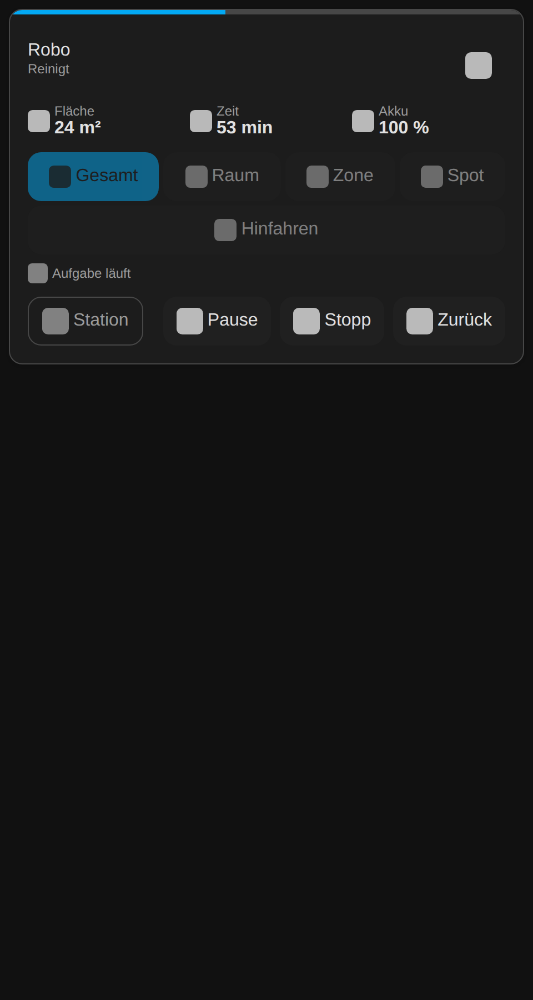
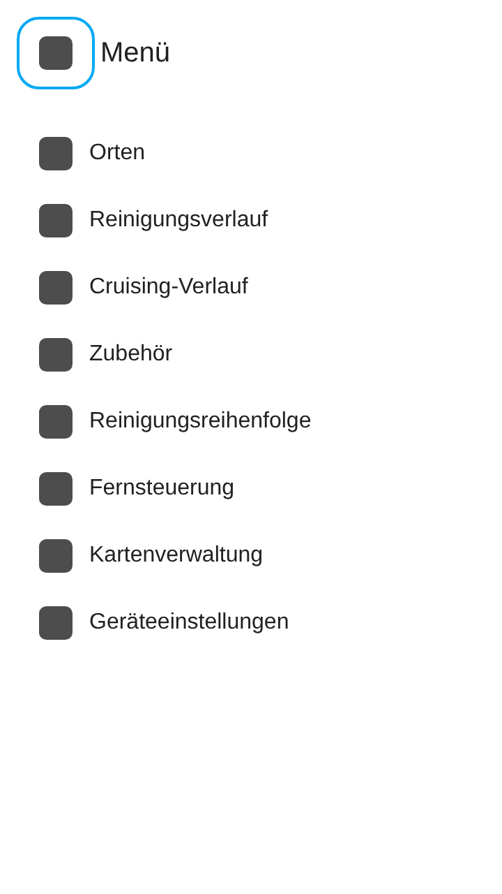

# Busch Vacuum Card

A robot vacuum card for Home Assistant: one card, **`busch-vacuum-card`**.
It aims to offer every function of the Dreame Vacuum Card that ships with
[Tasshack/dreame-vacuum][dreame] — status, control, cleaning tasks, dock,
device settings, history, remote control, map editing — built only on the
integration's public entities, attributes and services and styled like the
other Busch cards.

> **Work in progress.** Version 0.1.0 is a scaffold and not released yet.
> This README grows with each module.




## Requirements

- Home Assistant 2026.9.3 or newer
- A robot vacuum (`vacuum.*`); Dreame devices through
  [Tasshack/dreame-vacuum][dreame] 2.0 or newer get the full feature set

## Installation

HACS → three dots → *Custom repositories* → this repository, category
*Dashboard*. Then add the card from the card picker (*Busch vacuum*).

## Basic usage

Add the card from the card picker (*Busch vacuum*) and choose your robot
vacuum. That is all it needs: the card finds the device's other entities
(sensors, selects, switches, buttons, map cameras) by itself and shows only
what your device can do.

What you get with the core module:

- **Head:** name and state (in Home Assistant's language), cleaned area,
  cleaning time and battery (charging, low, charging to resume).
- **Task type:** All, Room, Zone, Spot, Go to (the map types need the map
  view, which follows in a later update). Locked while a task runs; the
  card shows whether the running task is scheduled or a shortcut.
- **Controls:** Clean, Pause, Resume, Stop, Return — depending on the state.
  The station status sits next to them and turns orange or red with a
  written reason.
- **Messages:** errors, warnings, info and low water; dismiss a message until
  it changes; clear a warning when the device allows it.
- **Menu:** Locate, plus the views your device supports (history, cruising
  history, accessories with a badge below 30 %, cleaning sequence, remote
  control, map management, device settings).
- Works in the normal dashboard and in a **panel view** (edge to edge, full
  height), with light and dark themes, in German and English.

## Configuration

Everything can be set in the visual editor; YAML is optional.

```yaml
type: custom:busch-vacuum-card
entity: vacuum.my_robot
```

| Option | Default | Description |
| --- | --- | --- |
| `entity` | — | The robot vacuum. Required. |
| `title` | device name | Heading of the card. |
| `scripts` | none | Scripts the shortcut menu offers ahead of the device shortcuts. |
| `full_height` | `false` | Fill the visible height below the Home Assistant header. |
| `aspect_ratio` | none | Fixed shape, e.g. `16:9`, `4/3` or `1.5` (not with `full_height` or in a panel). |
| `max_height_offset` | `0` | Pixels taken off the largest card height. |
| `left_handed` | `false` | Action buttons on the left, station status on the right. |
| `locked` | `auto` | When the map starts locked: `auto` (touch devices outside a panel), `only_touch`, `never`, `always`. |
| `touch_lock` | `200` | Hold time in ms (100–400) to toggle the lock. |
| `disable_haptic` | `false` | No vibration on taps. |
| `hidden_card_objects` | none | Parts to hide: `title`, `state`, `menu`, `status`, `task_type`, `controls`, `action_buttons`, `animations`, `shortcuts`, `cruising_history`, `error_message`, `warning_message`, `info_message`, `low_water_message`, `map_change_confirmation`, `progress_bar`, `dock_status_indicator`. |

Hiding `map_change_confirmation` changes maps without asking first.

## Theming

The card follows your Home Assistant theme. These optional theme variables
change its colours only:

| Variable | Used for | Falls back to |
| --- | --- | --- |
| `bvc-accent-color` | chosen task type, progress bar | `primary-color` |
| `bvc-warning-color` | warnings, station warning, accessory badge | `warning-color` |
| `bvc-error-color` | errors, station error, low battery | `error-color` |
| `bvc-success-color` | battery charging | `success-color` |
| `bvc-info-color` | info messages | `info-color` |

```yaml
my_theme:
  bvc-accent-color: "#2e7d32"
```

## License

MIT — see [LICENSE](LICENSE).

[dreame]: https://github.com/Tasshack/dreame-vacuum
